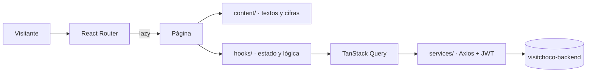

<div align="center">

# VisitChocó

**La plataforma digital del departamento del Chocó, Colombia.**
31 municipios, biodiversidad, cultura afro e indígena, historia y turismo, contados desde Quibdó.

[**visitchoco.dirsoft.cloud**](https://visitchoco.dirsoft.cloud)


</div>

---

## Contenido

- [Qué es VisitChocó](#qué-es-visitchocó)
- [Secciones del sitio](#secciones-del-sitio)
- [El Mundo: el Chocó en 3D](#el-mundo-el-chocó-en-3d)
- [Stack tecnológico](#stack-tecnológico)
- [Arquitectura](#arquitectura)
- [Rendimiento](#rendimiento)
- [Primeros pasos](#primeros-pasos)
- [Variables de entorno](#variables-de-entorno)
- [Scripts](#scripts)
- [Fotos optimizadas](#fotos-optimizadas)
- [API consumida](#api-consumida)
- [Pruebas y calidad](#pruebas-y-calidad)
- [Despliegue](#despliegue)
- [Flujo de trabajo](#flujo-de-trabajo)
- [Créditos y licencias](#créditos-y-licencias)

---

## Qué es VisitChocó

VisitChocó es una guía interactiva del Chocó pensada para quien lo visita, para quien lo estudia y para quien lo habita. Reúne en un solo lugar:

- **Un mapa vivo** de los 31 municipios, con subregiones, resguardos indígenas, composición étnica (DANE) y fiestas patronales.
- **Contenido editorial** sobre fauna, cultura, historia y turismo, con fuentes oficiales citadas.
- **Un directorio de prestadores turísticos** basado en el Registro Nacional de Turismo (RNT).
- **Un recorrido 3D** del territorio que se maneja en chiva o en panga.
- **Información de emergencia** cuando el departamento la necesita, como la página del sismo del 10 de agosto de 2026.

Es el frontend del proyecto. Los datos dinámicos vienen de [visitchoco-backend](#api-consumida).

---

## Secciones del sitio

| Ruta | Página | Qué ofrece |
|---|---|---|
| `/` | **Inicio** | Carrusel de fotos del territorio, accesos rápidos, municipios, patrimonio y cifras clave. |
| `/mapa` | **Mapa interactivo** | Leaflet a pantalla completa: municipios, subregiones, resguardos indígenas, mapa de calor étnico, fiestas, favoritos, geolocalización y enlaces compartibles (`?m=quibdo`). |
| `/animales` | **Fauna** | Especies emblemáticas, parques naturales y temporada de ballenas. |
| `/cultura` | **Cultura** | Patrimonio inmaterial, chirimía, gastronomía y tradiciones. |
| `/historia` | **Historia** | Línea de tiempo, cimarronaje y personajes del Chocó. |
| `/turismo` | **Turismo** | Destinos, temporadas y Registro Nacional de Turismo. |
| `/fiestas` | **Fiestas** | Calendario anual de fiestas patronales y San Pacho. |
| `/atrato` | **El río Atrato** | Relato editorial del primer río sujeto de derechos en Colombia (Sentencia T-622 de 2016). |
| `/directorio` | **Directorio** | Prestadores turísticos con filtros por municipio y categoría. |
| `/negocio/:slug` | **Ficha de negocio** | Contacto, WhatsApp y mini mapa de ubicación. |
| `/sismo` | **Sismo 2026** | Teléfonos, cómo ayudar, cronología, impacto y geología del sismo Mw 7,4 de San José del Palmar. |
| `/mundo` | **Mundo 3D** | Recorrido manejable del territorio ([ver abajo](#el-mundo-el-chocó-en-3d)). |
| `/acerca` · `/fuentes` | **Acerca y fuentes** | Propósito del proyecto y fuentes oficiales (DANE, IGAC, Ministerio de las Culturas, Cámara de Comercio…). |
| `/login` · `/admin/dashboard` · `/user/dashboard` | **Cuentas** | Acceso con JWT y paneles por rol. |

---

## El Mundo: el Chocó en 3D

`/mundo` es un diorama del departamento construido con **React Three Fiber** y física **Rapier**. El terreno se genera a partir del polígono real del Chocó (`public/data/chocoRegion.geojson`).

**Qué hay en el mundo**

- **Terreno procedural** con costa, playas, el valle del río Atrato y relieve generado con ruido determinista.
- **La Vía del Chocó**, trazada sobre el espinazo real del polígono, con puente sobre el Atrato.
- **Una chiva** como vehículo, con suspensión, sombras de contacto y auto-enderezado. En el agua se convierte en **panga**.
- **Lugares reconocibles**: el Malecón de Quibdó, la plaza de la chirimía, el varadero y las luces de los municipios.
- **Vegetación y fauna procedurales**, agua estilizada, sonido ambiente y minimapa.
- **Calidad adaptativa** (`low`, `medium`, `high`): se elige según la GPU detectada y se ajusta en vivo según los FPS.

**Controles**

| Acción | Teclado | Móvil |
|---|---|---|
| Acelerar / reversa | `W` `S` o `↑` `↓` | Botones táctiles |
| Girar | `A` `D` o `←` `→` | Joystick |
| Volver al inicio | `R` | — |
| Enderezar el vehículo | `Espacio` | — |

El Mundo se descarga solo cuando alguien entra a `/mundo`. No afecta el peso del resto del sitio.

---

## Stack tecnológico

| Capa | Tecnología |
|---|---|
| Interfaz | React 19 + TypeScript (modo estricto) |
| Build | Vite 7 |
| Estilos | Tailwind CSS 3.4, Framer Motion |
| Rutas | React Router 7, con carga diferida por página |
| Datos | TanStack Query + Axios (cliente único con JWT) |
| Mapa | Leaflet, React Leaflet, MarkerCluster, Turf |
| 3D | Three.js, React Three Fiber, Drei, Rapier, Postprocessing |
| Tipografía | Playfair Display, Poppins y Fraunces servidas desde el propio sitio |
| Pruebas | Vitest + Testing Library (jsdom) |
| Analítica | Cloudflare Web Analytics (sin cookies) |
| Paquetes | pnpm |

---

## Arquitectura

### Principios

- **Co-localización.** Cada página agrupa sus propios componentes en `pages/<Página>/components/`. En `src/components/` solo vive lo que comparten varias páginas.
- **Contenido separado del código.** Los textos y cifras editoriales viven en `src/content/`. Por ejemplo, `Sismo.tsx` no contiene ni una cifra: todas vienen de `sismoData.ts`.
- **Un solo cliente HTTP.** Todas las llamadas pasan por `services/api.service.ts`, que agrega el token JWT.
- **Carga diferida.** Solo el inicio va en el paquete principal; cada página se descarga cuando alguien la visita.

### Flujo de una página



### Estructura

```
src/
├── App.tsx                 # Rutas, Suspense y ErrorBoundary por ruta
├── main.tsx                # QueryClient, AuthProvider y estilos globales
├── components/
│   ├── layout/             # MainNav, SearchModal, footers, EmergencyBanner
│   ├── map/                # Mapa: panel lateral, detalle y controles flotantes
│   ├── common/             # ErrorBoundary, PrivateRoute, <Foto>
│   ├── ui/                 # CountUp, Skeleton, Fuente
│   └── auth/ · brand/ · features/
├── pages/
│   ├── Landing/ Map/ Fauna/ Cultura/ Historia/ Tourism/ Festival/
│   ├── Atrato/ Directorio/ Negocio/ Sismo/ Acerca/ Fuentes/
│   ├── Mundo/              # Experiencia 3D
│   │   ├── components/     # Terreno, Chiva, Vehicle, Water, Vegetation, cámara, audio…
│   │   └── utils/          # Geometría de la vía, geo, calidad adaptativa, uniforms
│   └── Login/ Register/ Dashboard/ NotFound/
├── content/                # Datos editoriales: fauna, fiestas, sismo, fuentes
├── data/                   # Slugs de municipios y accesos rápidos
├── hooks/                  # useMapState, useFiestas, useEthnicHeatmap, useGeolocation…
├── services/               # api.service + municipios, resguardos, etnias, clima
├── context/                # AuthContext (JWT y rol)
├── providers/              # AccentProvider (color de acento por ruta)
├── lib/                    # cn(), curvas de animación, fechas
├── config/ · types/ · utils/ · styles/
└── test/                   # Configuración de Vitest

public/
├── data/                   # chocoRegion.geojson
├── images/                 # Fotos originales
├── images/opt/             # Copias optimizadas (pnpm fotos)
├── fonts/ · sounds/ · models/

scripts/optimizar-fotos.mjs # Genera AVIF/WebP/JPG a la medida
deploy/nginx/cache.conf     # Reglas de caché del servidor
```

---

## Rendimiento

Medido en un teléfono con 4G simulado:

| | Antes | Ahora |
|---|---|---|
| Peso de la página de inicio | 23,3 MB | **1,9 MB** |
| Primera foto visible | 16 s | **0,5 s** |
| JavaScript inicial (gzip) | 228 KB | **113 KB** |

Cómo se logra:

- **Rutas diferidas** con `React.lazy`. Leaflet, Lottie y el Mundo 3D no se descargan en el inicio.
- **Fotos responsivas**. `<Foto>` arma un `<picture>` con AVIF, WebP y JPG, y el navegador elige el tamaño que su pantalla necesita.
- **Precarga de la primera foto** desde `index.html`, en paralelo con el JavaScript.
- **Caché agresiva** para archivos con huella en el nombre (un año) y revalidación para fotos y fuentes.
- **Fuentes propias** en lugar de Google Fonts.

---

## Primeros pasos

### Requisitos

- **Node.js** 20.19 o superior
- **pnpm** 10 o superior
- Opcional: una instancia de **visitchoco-backend** para los datos dinámicos. Sin ella, el contenido editorial funciona y el mapa queda sin datos.

### Instalación

```bash
git clone https://github.com/Bello2005/visitchoco-frontend.git
```

```bash
cd visitchoco-frontend && pnpm install
```

```bash
cp .env.example .env.local
```

```bash
pnpm dev
```

El sitio queda en **http://localhost:5173**.

---

## Variables de entorno

| Variable | Uso | Valor por defecto |
|---|---|---|
| `VITE_API_BASE_URL` | Origen de la API, sin `/` final. | `https://visitchoco-backend.vercel.app` |
| `VITE_APP_ENV` | `development` o `production`. | — |
| `VITE_API_URL` | Base de las rutas de autenticación (`buildApiUrl`). | `http://localhost:8000` |

> Todo lo que empieza con `VITE_` termina visible en el navegador. **Nunca** pongas llaves secretas aquí: las de terceros (por ejemplo, OpenWeather) viven solo en el backend.

---

## Scripts

| Comando | Qué hace |
|---|---|
| `pnpm dev` | Servidor de desarrollo con recarga en caliente |
| `pnpm build` | Verificación de tipos + build de producción en `dist/` |
| `pnpm preview` | Sirve `dist/` localmente |
| `pnpm test` | Ejecuta las pruebas una vez |
| `pnpm test:watch` | Pruebas en modo observación |
| `pnpm lint` | ESLint |
| `pnpm fotos` | Genera las copias optimizadas de las fotos |

---

## Fotos optimizadas

Las fotos originales se guardan intactas en `public/images/`. Para agregar o cambiar una:

1. Copia el original en `public/images/hero/` o `public/images/municipios/`.
2. Ejecuta `pnpm fotos`. El script crea copias AVIF, WebP y JPG en varios anchos dentro de `public/images/opt/` y actualiza `src/components/common/fotos.generadas.ts`. Las fotos del carrusel reciben además un recorte vertical para teléfonos.
3. Úsala con el componente `<Foto>`, igual que un ``:

```tsx
<Foto src="/images/municipios/quibdo.jpg" alt="Malecón de Quibdó" sizes="(min-width: 768px) 33vw, 100vw" />
```

El script solo rehace lo que falta o lo que cambió. Si una foto no tiene copias, `<Foto>` muestra el original.

---

## API consumida

El frontend consume **visitchoco-backend** bajo `/api`:

| Recurso | Endpoints |
|---|---|
| Municipios | `GET /api/municipalities` · `GET /api/municipalities/:slug` |
| Población y etnias (DANE) | `GET /api/population/:codDane` · `GET /api/ethnic` · `/latest` · `/stats` · `/summary/total` · `/summary/by-year` · `/:codDane` · `GET /api/ethnic-distribution/:codDane` |
| Resguardos indígenas | `GET /api/indigenous` · `/:id` · `/municipality/:codDane` |
| Fiestas | `GET /api/fiestas` · `/proximas` · `GET /api/festivals/municipality/:id` |
| Patrimonio | `GET /api/patrimonio/material/:municipio` · `/inmaterial/:municipio` |
| Turismo | `GET /api/rnt/:municipio` · `GET /api/establecimientos?municipio_id=` |

Si la API de fiestas no responde, el sitio usa los datos de respaldo de `src/content/fiestaData.ts`.

---

## Pruebas y calidad

```bash
pnpm test
```

- **Autenticación**: `AuthContext` y `PrivateRoute`.
- **Mundo 3D**: la geometría de la vía (`roadGeometry.test.ts`) y una prueba que genera el terreno real y verifica que ningún triángulo del asfalto quede invertido (`road-map-check.test.tsx`).

TypeScript corre en modo estricto y `pnpm build` falla si hay errores de tipos.

---

## Despliegue

### Servidor propio (producción actual)

El sitio corre en un VPS con Ubuntu y **Nginx**, que sirve `dist/` como archivos estáticos. Las reglas de caché están en `deploy/nginx/cache.conf` y se incluyen dentro del bloque `server` del sitio.

Para publicar una versión nueva sin dejar el sitio caído mientras compila:

```bash
cd /var/www/visitchoco/frontend && git fetch origin && git checkout -B main origin/main
```

```bash
pnpm install --frozen-lockfile
```

```bash
pnpm exec tsc -b && pnpm exec vite build --mode production --outDir dist-nuevo
```

```bash
rm -rf dist-anterior && mv dist dist-anterior && mv dist-nuevo dist
```

```bash
nginx -t && systemctl reload nginx
```

Para volver a la versión anterior:

```bash
rm -rf dist && mv dist-anterior dist
```

### Vercel u otro hosting estático

`vercel.json` ya incluye la reescritura de rutas de la SPA y los encabezados de caché.

1. Comando de build: `pnpm build`
2. Carpeta de salida: `dist/`
3. Configura `VITE_API_BASE_URL` en las variables de entorno de la plataforma.

---

## Flujo de trabajo

- **`dev`**: rama de trabajo diario.
- **`main`**: versión estable, la que se publica.

Los commits van en español, con el área primero:

```
mundo: dar tiempo suficiente al test de la vía sobre el mapa real
hero: usar fotos WebP responsivas en Landing y Login
app: reiniciar el ErrorBoundary al cambiar de ruta
```

Antes de subir, ejecuta `pnpm test` y `pnpm build`.

---

## Créditos y licencias

### Código

VisitChocó se distribuye bajo la licencia **GNU GPL v3.0**. Ver [`LICENSE`](LICENSE).

### Mundo 3D

`/mundo` adapta técnicas de los portafolios open source de **Bruno Simon** ([folio-2019](https://github.com/brunosimon/folio-2019) y [folio-2025](https://github.com/brunosimon/folio-2025), licencia MIT). El detalle de qué se adaptó y la licencia completa están en [`src/pages/Mundo/CREDITS.md`](src/pages/Mundo/CREDITS.md).

El audio del Mundo (música CC0; viento y grillos MIT) está atribuido en [`public/sounds/mundo/README.md`](public/sounds/mundo/README.md).

### Datos

DANE, IGAC, el Ministerio de las Culturas, las Artes y los Saberes, la Cámara de Comercio del Chocó y OpenWeather (a través del backend). La lista completa está en la página [`/fuentes`](https://visitchoco.dirsoft.cloud/fuentes) y en `src/content/dataSources.ts`.

### Equipo

- **Deiner David Bello González** · [Bello2005](https://github.com/Bello2005)
- **Josser** · [IngenieroJosser](https://github.com/IngenieroJosser)

---

<div align="center">

Hecho con orgullo en **Quibdó, Chocó** · [dirsoft.cloud](https://dirsoft.cloud)

</div>
